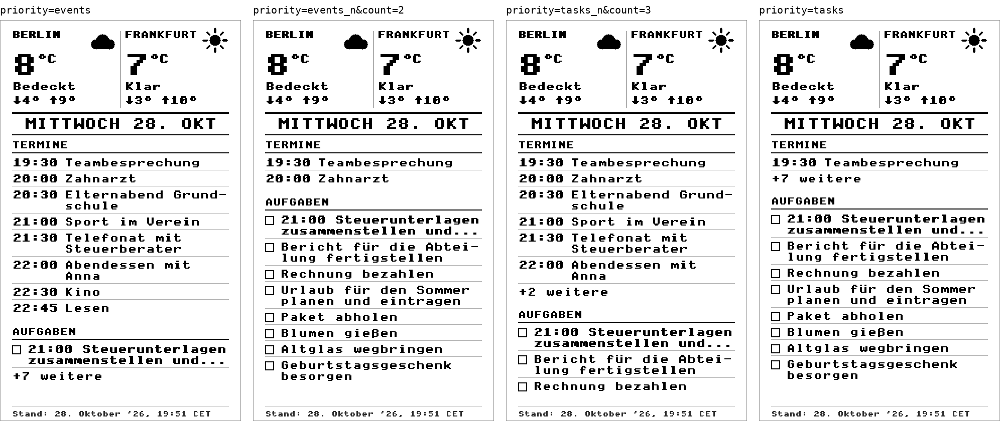
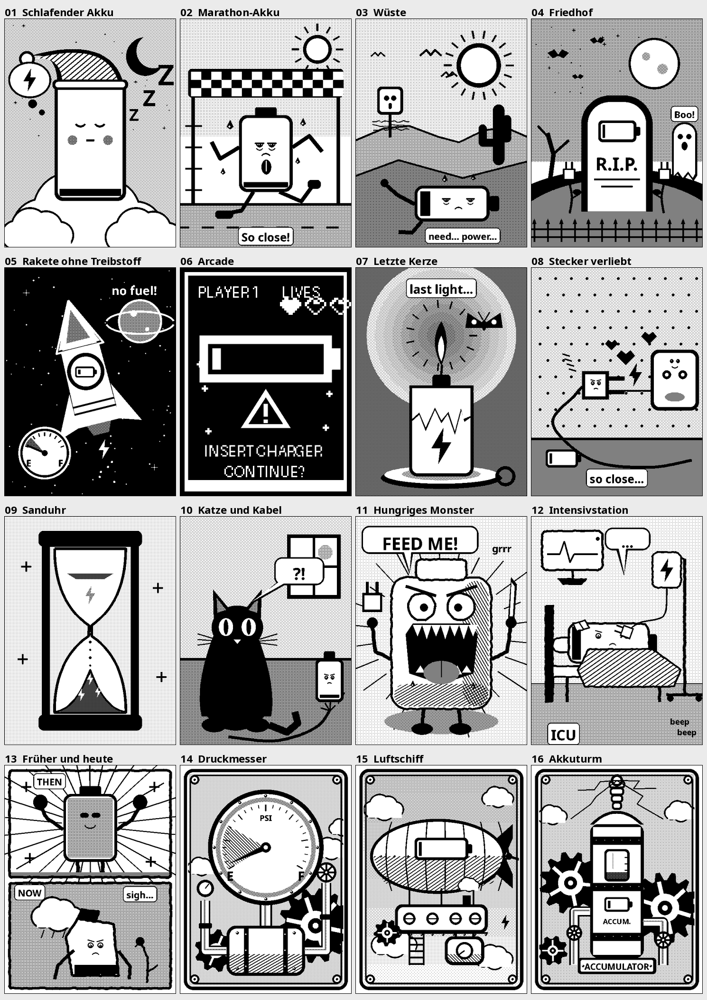

[English](README.md) · [Deutsch](README.de.md) · **Français** · [Español](README.es.md)

# Écran de veille « calendrier » pour la Xteink X4 Pro

**Fork non officiel de [CrossPoint Reader](https://github.com/crosspoint-reader/crosspoint-reader) 1.6.5.**
Votre Xteink X4 Pro affiche votre journée comme écran de veille : la météo de deux lieux, les rendez-vous du
jour de Google Agenda et les tâches du jour de Todoist.

<p align="center">
  <br>
  <em>Image d'exemple avec des données fictives, telle qu'elle apparaît sur l'écran (480x800, niveaux de gris)</em>
</p>

> Projet non officiel. Aucun lien avec le projet CrossPoint Reader ni avec Xteink.
> Testé sur une seule X4 Pro, utilisation à vos risques, sans aucune garantie.

**Deux parties qui vont ensemble :**
- 🧩 **Firmware** (ce dépôt) : [crosspoint-calendar-task-screen](https://github.com/RockyBalboa360/crosspoint-calendar-task-screen/tree/feature/calendar-sleep-screen), **dernière version : [Releases](https://github.com/RockyBalboa360/crosspoint-calendar-task-screen/releases/latest)**
- ☁️ **Serveur d'image** (Cloudflare Worker) : [worker-for-crosspoint-calendar-task-screen](https://github.com/RockyBalboa360/worker-for-crosspoint-calendar-task-screen)

## Fonctionnement
1. Un petit **serveur** (Cloudflare Worker) récupère la météo, les rendez-vous et les tâches et en dessine une image :
   [worker-for-crosspoint-calendar-task-screen](https://github.com/RockyBalboa360/worker-for-crosspoint-calendar-task-screen).
2. Ce **firmware** ajoute un nouvel écran de veille **« Calendar »** et le réglage **« Calendar Server URL »**.
3. Quand l'appareil s'endort, il se connecte à votre réseau WiFi enregistré, télécharge l'image depuis cette URL et
   l'affiche comme écran de veille. En cas d'échec, la dernière image téléchargée reste affichée.

## Installation
1. Téléchargez `firmware.bin` depuis la [dernière version](https://github.com/RockyBalboa360/crosspoint-calendar-task-screen/releases/latest)
   et copiez-le à la racine de la carte SD.
2. Sur l'appareil : *Settings → System → SD Card Firmware Update*, choisissez le fichier et confirmez.
   Le firmware précédent reste dans le second emplacement de programme.
3. *Settings → System → WiFi Networks* : enregistrez votre réseau WiFi.
4. *Settings → Display → Calendar Server URL* : saisissez l'adresse de votre worker
   (par exemple `https://votre-worker.votre-nom.workers.dev`).
5. *Settings → Display → Sleep Screen → Calendar*.

La configuration du worker (compte de service Google, jeton Todoist, lieux) est décrite dans son
[README](https://github.com/RockyBalboa360/worker-for-crosspoint-calendar-task-screen#readme).
Les menus de l'appareil sont en anglais ou en allemand ; les noms des menus sont donnés ici en anglais.

## Rendez-vous ou tâches en premier ?
Les rendez-vous et les tâches se partagent la place sous la météo. Sous *Settings → Display*, vous décidez qui
passe en premier :

| *Calendar priority* | Effet |
|---|---|
| *All events* | tous les rendez-vous du jour, les tâches reçoivent le reste |
| *Fixed events* | exactement N rendez-vous, les tâches reçoivent le reste (par défaut, N = 3) |
| *Fixed tasks* | exactement N tâches, les rendez-vous reçoivent le reste |
| *All tasks* | toutes les tâches, les rendez-vous reçoivent le reste |

*Fixed count* définit N (de 1 à 8). Si tout ne tient pas, la section se termine par « +N weitere » (« +N de plus »,
en allemand, car le worker est en allemand). Une section vide ne prend qu'une ligne.

<p align="center">
  <br>
  <em>Les quatre dispositions (de gauche à droite) : tous les rendez-vous, 2 rendez-vous, 3 tâches, toutes les tâches</em>
</p>

Le firmware ajoute ce choix à l'URL du serveur sous la forme `?priority=…&count=…`. Il faut pour cela le worker à jour ;
un ancien worker l'ignore et garde sa disposition fixe.

## Bon à savoir
- L'image est téléchargée **quand l'appareil s'endort**, manuellement ou après le délai d'inactivité. Elle reste ensuite
  affichée jusqu'à ce que vous réveilliez l'appareil et le laissiez se rendormir. Il n'y a pas de réveil programmé.
- Sous **10 % de batterie**, l'appareil ne télécharge rien. Il affiche à la place une image « Batterie faible » avec le
  niveau de charge. Après la recharge, le calendrier est actualisé à la prochaine mise en veille.
- Choisissez l'**image de batterie faible** sous *Settings → Display → Low battery screen* : une galerie avec l'icône de
  batterie simple et **16 dessins** (une batterie classique, 3 motifs futuristes de circuits, 9 dessins humoristiques et
  3 motifs steampunk). Balayez l'écran ou utilisez les touches latérales pour parcourir ; les boutons tactiles
  « Choose » et « Cancel » en bas valident l'image affichée ou quittent la galerie.
- L'image doit être un BMP de 480x800 pixels. Le worker fournit exactement cela.
- L'adresse de votre worker est publique. Quiconque la connaît peut voir vos rendez-vous et vos tâches. Ne la partagez pas.
- Une mise à jour via « Check for updates » remplace ce firmware par le firmware officiel.

<p align="center">
  <br>
  <em>Les 16 images de batterie faible au choix (sous chaque image, l'appareil affiche « Batterie faible » et le niveau de charge)</em>
</p>

## Ce qui change par rapport à CrossPoint 1.6.5
Sont nouveaux : `src/network/CalendarFetcher.{h,cpp}` ainsi que de petites modifications dans `SleepActivity`,
`SettingsActivity`, les réglages et les traductions (anglais et allemand). Tout le reste est inchangé. La liste
exacte, les instructions de compilation et toutes les licences se trouvent dans [FORK_NOTICE.md](FORK_NOTICE.md).
Le mode d'emploi d'origine est [USER_GUIDE.md](USER_GUIDE.md).

## Compiler soi-même
```
git clone --recurse-submodules https://github.com/RockyBalboa360/crosspoint-calendar-task-screen
cd crosspoint-calendar-task-screen
git checkout feature/calendar-sleep-screen
pio run -e x4pro-gh_release
```
Le fichier final se trouve ensuite dans `.pio/build/x4pro-gh_release/firmware.bin`.

## Mentions légales et sources
- Basé sur **CrossPoint Reader** (MIT, Copyright (c) 2025 CrossPoint Reader organization). Le fichier
  [LICENSE](LICENSE) est inchangé. Mes modifications sont également sous licence MIT.
- Le firmware contient des bibliothèques avec leurs propres licences, notamment **wolfSSL (GPL-2.0 ou ultérieure)** et
  arduinoWebSockets (LGPL-2.1). Les textes des licences sont dans [third_party_licenses/](third_party_licenses/), les
  sources et les versions dans [FORK_NOTICE.md](FORK_NOTICE.md).
- « Xteink » et « CrossPoint » sont des noms appartenant à leurs titulaires respectifs et ne sont utilisés ici qu'à
  titre descriptif.
- Les modifications ont été réalisées avec l'aide de Claude Code (Anthropic), puis vérifiées et publiées par le
  propriétaire du dépôt.

Projet d'origine : <https://github.com/crosspoint-reader/crosspoint-reader>
